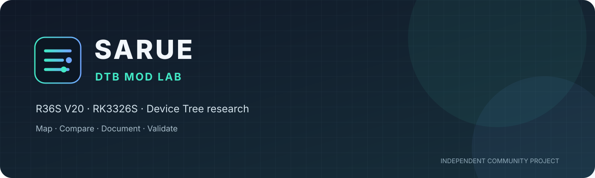

# SARUE · R36S V20 DTB Mod

**Pesquisa, mapeamento e validação de Device Tree Blobs para consoles portáteis RK3326.**

[Hardware e escopo](#escopo) · [Resultados observados](#resultados-observados) · [Método de mapeamento](docs/METODOLOGIA-MAPEAMENTO.md) · [Matriz de testes](docs/MATRIZ-DE-TESTES.md) · [Estrutura](docs/ESTRUTURA-DO-REPOSITORIO.md)

---

## Escopo

Este repositório reúne DTBs binários, fontes DTS, recortes de análise e experimentos relacionados ao **R36S V20, revisão identificada pelo usuário como 2025-05-18**, e a plataformas de referência da família RK3326.

O foco é entender diferenças de hardware descritas nos Device Trees e investigar compatibilidade de **controles, ADC/AMUX, display, backlight e áudio**, preservando o que já funciona no aparelho real.

> **Importante:** um DTB de uma placa RK3326 parecida não é automaticamente compatível com o R36S V20. Os arquivos E6, GKD Pixel2 e K36 neste repositório são referências de análise, não prova de equivalência elétrica.

## Resultados observados

- O DTB K36 registrado neste projeto inicializa o console de teste e produz imagem, mas os registros iniciais indicam problemas com controles e áudio no sistema usado.
- Os testes exploraram diferenças entre os drivers play_joystick e rocknix-singleadc-joypad, incluindo GPIO, canais SARADC e multiplexação analógica.
- O usuário relatou **aproximadamente 30% mais desempenho e maior estabilidade geral do sistema** no V20 com RK3326S em comparação com sua experiência anterior.

O resultado de desempenho é um **relato de teste do projeto**, não um benchmark universal. Ainda não há neste repositório um protocolo público reproduzível com cargas, versões de sistema, temperaturas, medições e resultados brutos suficientes para generalizar o percentual.

## Estado das evidências

| Área | Estado documentado | Como interpretar |
|---|---|---|
| Display K36 no console de teste | Imagem observada | Não substituir o painel/DSI sem validação física |
| Controles K36 | Problema registrado nos testes iniciais | Investigar driver, GPIO e ADC separadamente |
| Áudio K36 | Problema registrado nos testes iniciais | Comparar codec, I2S, routing e detecção de fone |
| E6 / GKD Pixel2 | Referências comparativas | Não presumir compatibilidade com o V20 |
| DTS experimental | Não presumido funcional | Requer compilação e teste no hardware |
| Ganho de desempenho de ~30% | Relato do usuário | Requer benchmark reproduzível para confirmação independente |

## Método de trabalho

1. **Identificar a origem** do DTB e confirmar para qual placa ele foi criado.
2. **Preservar o original** e registrar hash, tamanho, origem e versão do sistema sempre que possível.
3. **Descompilar para DTS** sem descartar o binário original.
4. **Mapear blocos relevantes**: model, compatible, display/DSI, backlight, joypad, adc-keys, SARADC, AMUX, GPIO, codec, I2S e rotas de áudio.
5. **Comparar os blocos correspondentes**, não apenas nomes de arquivos ou tamanhos.
6. **Criar uma hipótese por alteração** e manter cada experimento identificável.
7. **Compilar e validar sintaxe** antes de testar.
8. **Testar no console**, registrar o que funcionou e manter um caminho de reversão.

A metodologia detalhada, incluindo limites de segurança para GPIO/AMUX/ADC, está em [docs/METODOLOGIA-MAPEAMENTO.md](docs/METODOLOGIA-MAPEAMENTO.md).

## Navegação

- [Comparação inicial K36 × E6 × GKD Pixel2](analysis/initial-comparison.md)
- [Fontes DTS e recortes de display/teclas](dts/)
- [DTS experimentais](dts/experimental/)
- [Referência Aurknix K36](references/aurknix/rk3326-gameconsole-k36.dts)
- [DTBs binários de referência K36](K36/) e V20 candidatos (E6/Pixel2) em [V20/](V20/)
- [Método de mapeamento](docs/METODOLOGIA-MAPEAMENTO.md)
- [Matriz de validação](docs/MATRIZ-DE-TESTES.md)
- [Guia da estrutura](docs/ESTRUTURA-DO-REPOSITORIO.md)

## Segurança e reversão

- Faça backup do DTB original da partição de boot antes de qualquer substituição.
- Não grave um DTB experimental como arquivo de inicialização padrão.
- Preserve GPIO, pinctrl, SARADC e AMUX enquanto a função elétrica não estiver identificada com evidência.
- Teste uma variável por vez; se o console perder imagem ou entrada, restaure o backup pelo procedimento específico do sistema utilizado.
- Não trate “compila sem erro” como sinônimo de “funciona no hardware”.

## Identidade e créditos

Projeto independente **Sarue / OlhaGatito**, voltado a pesquisa e documentação comunitária. Nomes de sistemas, placas, drivers e projetos de terceiros pertencem aos respectivos autores. A inclusão de uma referência não implica endosso nem garante compatibilidade.

---

**SARUE · Mapear antes de modificar. Validar antes de recomendar.**

